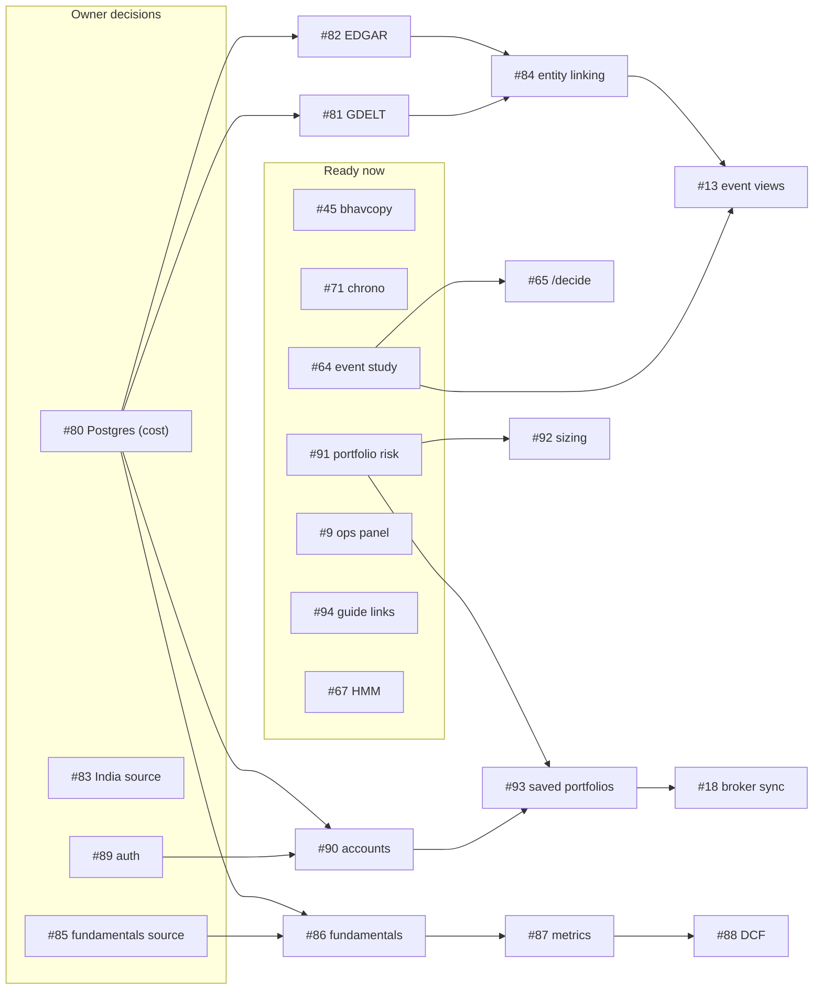

# Roadmap

What has been built and what comes next, in order. This file is the public source of truth for the
work queue; the GitHub issues hold the full work packages. **Update it in the same PR that closes
an issue** (part of the [Definition of Done](../CONTRIBUTING.md#definition-of-done)).

- Detailed design: [docs/plans/](plans/README.md)
- What works today, in plain terms: [docs/STATUS.md](STATUS.md)
- Why things are the way they are: [docs/HISTORY.md](HISTORY.md)
- How to work in this repo (humans and AI agents): [AGENTS.md](../AGENTS.md) and [CONTRIBUTING.md](../CONTRIBUTING.md)

## How to pick the next item

1. Take the **first row in "Next" labelled `agent-ready`** whose blockers are closed.
   `gh issue list --label agent-ready` shows the same set.
2. Comment "taking this" on the issue and assign yourself, so two people don't take the same item.
3. Follow its work package. Open one PR per issue that says `Closes #N`.

Item states (GitHub labels):
- **`agent-ready`:** fully specified and unblocked. Anyone can start, human or agent.
- **`needs-owner-input`:** waiting for the owner: keys, money, or a product decision. Research
  toward the decision is welcome.
- **`blocked`:** waiting on the issues listed in its *Dependencies*.

## Done

| Milestone | What shipped | PRs / issues |
|---|---|---|
| v0.1.0-mv | Deterministic fixture console: event inbox, decision workbench, Razorpay test mode, release automation | #27–#33 |
| 0.1 Data foundation | Yahoo provider (any exchange), adjusted bars, quality report, `/api/v1` search/bars/quote, access gate, live SSE stream, Markets view, TradingView widget, local pre-push gate, deploy from `main` | #72 (closes #34–#42), #43 |
| 0.1 (live data) | Measured live: NSE ~2 s, BSE 15 min delayed; the UI labels delayed feeds | #76 (closes #44) |
| 0.2 Analysis engine | Distribution, predictability tests, EWMA + GARCH-t, Monte Carlo fans, VaR/ES, drawdown, beta vs home-market index; verified against scipy/statsmodels/arch | #73 (closes #46–#52) |
| 0.3 Validation harness | Walk-forward scoring: pinball loss, Diebold–Mariano, Kupiec/Christoffersen VaR backtests, per-model verdict | #74 (closes #53–#56) |
| 0.4 Multi-instrument | Compare 2–10 instruments: correlation (daily/rank/weekly), Ledoit–Wolf, PCA, Engle–Granger cointegration, relative performance | #77 (closes #57–#60) |
| 0.5 Analyze web app | Analysis panels, Compare tab, How it works guide | #73, #77 (closes #61–#63) |
| Hardening | Search errors are no longer silent empty results | #78 |
| Docs | AGENTS.md / CLAUDE.md, history, plans, this roadmap, work packages | #75, #79, this PR |

## Next, in order

| Order | Issue | Goal | State | Blocked by |
|---|---|---|---|---|
| 1 | [#45](https://github.com/Chandrashekhar-Hegde/market-intelligence-core/issues/45) | NSE bhavcopy cross-check and fallback (spike: is it reachable from Railway?) | `agent-ready` | — |
| 2 | [#71](https://github.com/Chandrashekhar-Hegde/market-intelligence-core/issues/71) | Replace chrono (RUSTSEC advisory) | `agent-ready` | — |
| 3 | [#64](https://github.com/Chandrashekhar-Hegde/market-intelligence-core/issues/64) | Market-model event study (α + β, CAR significance) | `agent-ready` | — |
| 4 | [#91](https://github.com/Chandrashekhar-Hegde/market-intelligence-core/issues/91) | Portfolio risk from pasted holdings (stateless) | `agent-ready` | — |
| 5 | [#9](https://github.com/Chandrashekhar-Hegde/market-intelligence-core/issues/9) | Operations status panel: provider health, cache, stream | `agent-ready` | — |
| 6 | [#94](https://github.com/Chandrashekhar-Hegde/market-intelligence-core/issues/94) | Link each panel to its How it works section (good first issue) | `agent-ready` | — |
| 7 | [#67](https://github.com/Chandrashekhar-Hegde/market-intelligence-core/issues/67) | Two-state HMM regimes, kept only if validation says so | `agent-ready` | — |
| 8 | [#80](https://github.com/Chandrashekhar-Hegde/market-intelligence-core/issues/80) | Attach Postgres on Railway; event store | `needs-owner-input` (cost) | — |
| 9 | [#83](https://github.com/Chandrashekhar-Hegde/market-intelligence-core/issues/83) | Decide a lawful India announcements source | `needs-owner-input` | — |
| 10 | [#85](https://github.com/Chandrashekhar-Hegde/market-intelligence-core/issues/85) | Decide a free fundamentals source | `needs-owner-input` | — |
| 11 | [#89](https://github.com/Chandrashekhar-Hegde/market-intelligence-core/issues/89) | Decide the authentication approach | `needs-owner-input` | — |
| 12 | [#81](https://github.com/Chandrashekhar-Hegde/market-intelligence-core/issues/81), [#82](https://github.com/Chandrashekhar-Hegde/market-intelligence-core/issues/82) | GDELT news; SEC EDGAR filings | `blocked` | #80 |
| 13 | [#84](https://github.com/Chandrashekhar-Hegde/market-intelligence-core/issues/84) | Link events to instruments | `blocked` | #81, #82 |
| 14 | [#13](https://github.com/Chandrashekhar-Hegde/market-intelligence-core/issues/13) | Event markers and CAR chart | `blocked` | #64, #84 |
| 15 | [#65](https://github.com/Chandrashekhar-Hegde/market-intelligence-core/issues/65) | Calibrate or retire `/decide` | `needs-owner-input` | #64, #17 |
| 16 | [#86](https://github.com/Chandrashekhar-Hegde/market-intelligence-core/issues/86) → [#87](https://github.com/Chandrashekhar-Hegde/market-intelligence-core/issues/87) → [#88](https://github.com/Chandrashekhar-Hegde/market-intelligence-core/issues/88) | Fundamentals provider → quality metrics → Monte Carlo DCF | `blocked` | #85, #80 |
| 17 | [#90](https://github.com/Chandrashekhar-Hegde/market-intelligence-core/issues/90) | Accounts and sessions; retire the shared token | `blocked` | #89, #80 |
| 18 | [#92](https://github.com/Chandrashekhar-Hegde/market-intelligence-core/issues/92) | Sizing and rebalancing ranges | `blocked` | #91 |
| 19 | [#93](https://github.com/Chandrashekhar-Hegde/market-intelligence-core/issues/93) | Saved portfolios | `blocked` | #90, #91 |
| 20 | [#18](https://github.com/Chandrashekhar-Hegde/market-intelligence-core/issues/18) | Broker holdings sync (read-only) | `needs-owner-input` (keys) | #93 |
| 21 | [#68](https://github.com/Chandrashekhar-Hegde/market-intelligence-core/issues/68) | Broker live ticks | `needs-owner-input` (keys) | — |

Parent issues that group the steps: [#17](https://github.com/Chandrashekhar-Hegde/market-intelligence-core/issues/17)
(events), [#66](https://github.com/Chandrashekhar-Hegde/market-intelligence-core/issues/66) (fundamentals),
[#69](https://github.com/Chandrashekhar-Hegde/market-intelligence-core/issues/69) (accounts),
[#70](https://github.com/Chandrashekhar-Hegde/market-intelligence-core/issues/70) (portfolio).

## Dependencies

## Principles every item follows

These are the five in [AGENTS.md](../AGENTS.md#principles-non-negotiable): distributions not
calls, models earn their place out of sample, cite or calibrate, visible provenance, and a pure
domain layer. No live order placement, ever.

## Operating rule (from v0.1.0)

Do not add live network calls, clocks, random identifiers or database writes to the domain
scoring path. External inputs are collected upstream and passed in as explicit facts.
