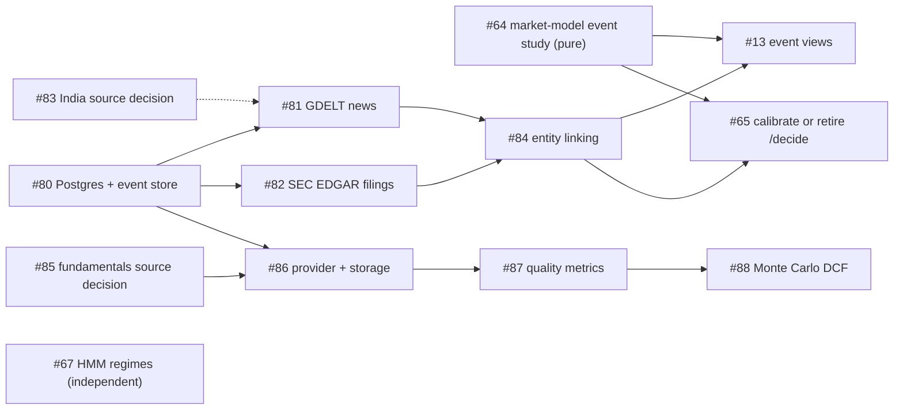

# Phase 1: real events and fundamentals

> **Status: Planned.** Milestone *Phase 1 Events & fundamentals*. Each step below is a GitHub issue
> with a full work package (why, scope, approach, acceptance criteria, verification). This document
> explains the order and the design that ties the steps together.

## Goal

Move the Event lab from fixtures to **real, dated events** (news and filings). Measure how prices
react to them with a **correct event study**. Add a **value layer** (company fundamentals and a
valuation given as a distribution). Keep the project's rules: cite or calibrate every constant,
show distributions rather than calls, validate out of sample, and keep provenance visible.

## Design in one picture

## Steps, in order

| # | Step | Can start | Notes |
|---|---|---|---|
| 1 | **#64 Market-model event study** | **now** | Pure `gm-domain/src/event_study.rs`. α/β from an estimation window [−250, −30] (MacKinlay 1997) with `analysis::numeric::ols`; CAR windows with t-statistics; a missing benchmark is an error. Reference values come from `scripts/gen_reference.py`. |
| 2 | **#67 HMM regimes** | **now** | Independent. A 2-state Baum–Welch model, added to `analysis/validation.rs`. It appears in findings only if it earns its place. |
| 3 | **#80 Persistence** | owner approval (cost) | Attach Railway Postgres. The existing migrations already hold `raw_events`/`normalized_events`. Add an idempotent upsert on (source, source_id). Update "How it works → what is stored" in the same PR. |
| 4 | **#83 India announcements source** | now (research) | The NSE website API is ruled out by its terms. Compare lawful options and quote their terms. The owner picks. |
| 5 | **#81 GDELT** and **#82 SEC EDGAR** | after #80 | Same provider pattern as `yahoo.rs` (pure parser, recorded fixtures, retries). A `gm-worker` ingestion command. EDGAR needs a generic contact User-Agent, never a personal email. |
| 6 | **#84 Entity linking** | after #81/#82 | Map identifiers and names to symbols with a confidence score. Low-confidence links are shown but not used in studies. |
| 7 | **#13 Event views** | after #64 and #84 | Markers on the candle chart, and a CAR chart with a confidence band and n. |
| 8 | **#65 `/decide`** | after #64 and #17 | An evidence-based recommendation to calibrate, reduce or retire it. The owner decides. |
| 9 | **#85 Fundamentals source** | now (research) | Compare free sources by terms, history depth and coverage (NIFTY 50, S&P 500). The owner picks. |
| 10 | **#86 → #87 → #88** | after #85 and #80 | Provider and storage, then cited quality metrics, then a seeded Monte Carlo DCF that reuses `analysis/montecarlo.rs` patterns. |

## Cross-cutting rules for this phase

- **Every new source** gets a written terms-of-use check in `docs/INTEGRATIONS.md` before code.
- **Every stored datum** carries its provenance: source, source id, fetched_at.
- **"How it works" stays truthful.** When persistence lands, its "what is stored" section changes
  in the same PR.
- **Tests:** domain maths against a Python reference; providers on recorded fixtures; API on stubs;
  UI with Vitest, Playwright and axe. These are the same layers as Phase 0 (see `AGENTS.md`).

## Done when

The Event lab shows real events with sources. An event study on them reports CAR with confidence
intervals. `/decide` is either calibrated or retired. A user can see fundamentals and a DCF value
distribution for at least NIFTY 50 and S&P 500 constituents.
