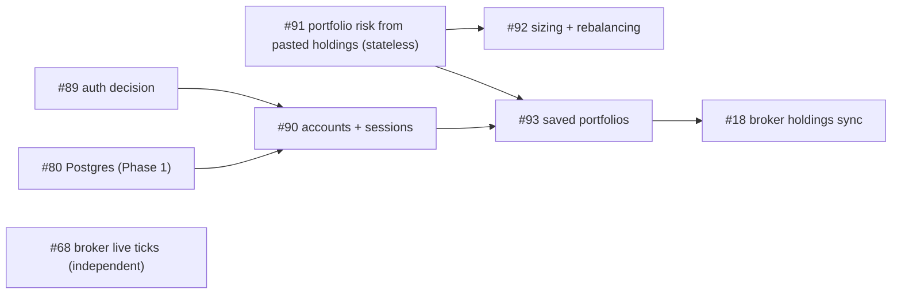

# Phase 2: portfolio, accounts, broker data

> **Status: Planned.** Milestone *Phase 2 Portfolio & live data*. Each step is a GitHub issue with a
> full work package. This document explains the order and design.

## Goal

Analyse a **whole portfolio** with the engines that already exist (`analysis`, `multi`, `risk`):
portfolio risk, what drives it, and sizing ranges that respect estimation error. Then add
**accounts** so portfolios can be saved, and optional **broker connections** for holdings and
licensed live ticks. **No order placement, ever**: `ExecutionMode::Live` stays disabled.

## Design in one picture

## Steps, in order

| # | Step | Can start | Notes |
|---|---|---|---|
| 1 | **#91 Portfolio risk, stateless** | **now** | `POST /api/v1/portfolio/analyze` with holdings in the request; nothing is stored. Reuse `multi` (alignment, Ledoit–Wolf, PCA) and `risk`. Euler risk contributions (Tasche 1999) must sum to total risk. Python reference for the portfolio maths. A Portfolio tab with paste or CSV input. |
| 2 | **#92 Sizing and rebalancing** | after #91 | Fractional-Kelly *ranges* that widen with drift uncertainty (Kelly 1956, Thorp 2006). Rebalancing net of costs. Never a single "buy N". |
| 3 | **#89 Auth decision** | now (research) | Magic link vs OAuth vs passkeys vs a managed provider, with a threat model. The owner picks. |
| 4 | **#90 Accounts and sessions** | after #89 and #80 | Extend `access_gate` in `gm-api/src/lib.rs`. HttpOnly, Secure, SameSite cookies. Migrate off the shared token. Update "How it works → what is stored". |
| 5 | **#93 Saved portfolios** | after #90 and #91 | Tables `portfolios` and `holdings` (`decisions.portfolio_id` already exists). Ownership checks on every query, with tests. |
| 6 | **#18 Broker holdings sync** | after #93; owner keys | Read-only OAuth with one broker, daily token refresh, encrypted tokens. Tests prove no order endpoint is reachable. |
| 7 | **#68 Broker live ticks** | owner keys | `BrokerTickProvider` emitting the same `Tick` as `yahoo_stream.rs`, falling back to Yahoo. Personal use only (NSE redistribution rules). |

## Done when

A user can paste or sync a portfolio and see its VaR/ES, risk contributions, factor exposure and
sizing ranges, all validated against references. Signed-in users can save portfolios. No path in
the codebase can place an order.
